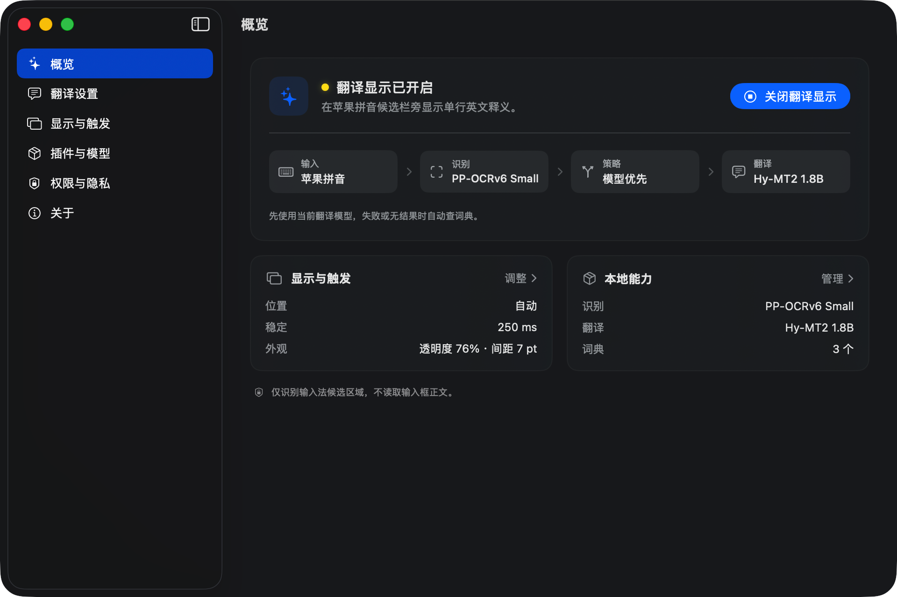
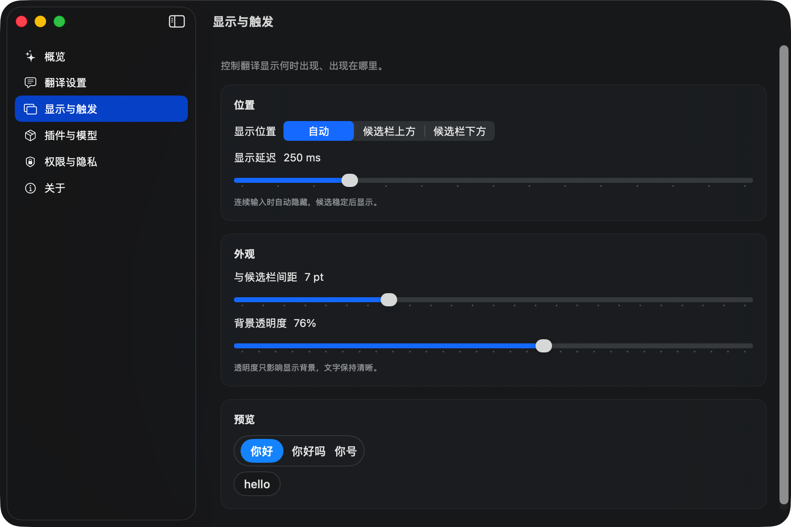

# Glint

面向中文母语者的 macOS 英文学习工具：读取苹果拼音焦点候选，在候选栏旁显示单行英文。



Glint 不替换苹果输入法，不抢焦点，也不打断输入。它跟随当前候选，在你打字时显示
最相关的英文表达，让日常输入自然成为轻量的英语练习。

## 功能

- 跟随苹果拼音的高亮候选，在候选栏旁实时显示英文
- 支持单词、短语和短句
- 单词显示多个常用英文对应词，短句显示自然英文翻译
- Apple Vision 开箱即用，可安装 PP-OCRv6 提升复杂场景准确率
- 离线词典与本地翻译模型按需安装，失败时自动回退
- 显示位置、延迟、间距和透明度均可调整

## 使用场景

- 在聊天、邮件和文档中输入中文时，顺手学习地道英文表达
- 不确定中文词对应的英文时，直接查看候选栏旁的提示
- 写英文邮件或文案时，用整句翻译确认表达



## 运行

当前处于早期开发阶段，需要从源码构建：

```bash
git clone https://github.com/jsogn/Glint.git
cd Glint
./scripts/run.sh
```

需要 macOS 14+、Apple Silicon、Xcode 26 和 XcodeGen。

## 开始使用

1. 打开 Glint。
2. 按提示授权屏幕录制和辅助功能。
3. 切换到苹果拼音，正常输入中文即可看到英文显示。

## 隐私

Glint 不保存候选文本、翻译结果或输入历史。默认使用本地 OCR、词典和翻译模型；
如果主动启用 OpenAI 兼容接口，当前候选文本会发送到所配置的服务。

## 系统要求

- macOS 14 或更高版本
- Apple Silicon Mac
