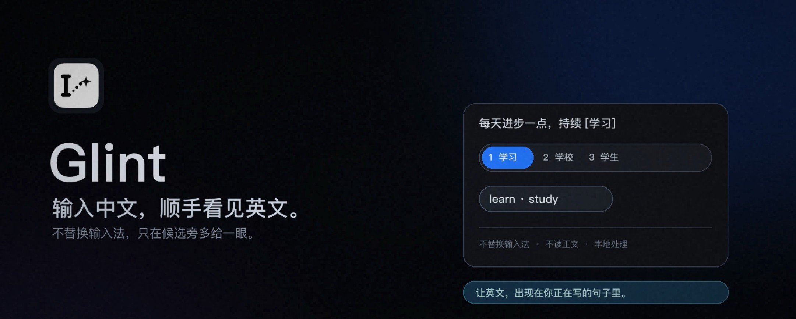

<p align="center">
  
</p>

<p align="center">
  <a href="https://github.com/jsogn/Glint/releases/latest">
    
  </a>
  
  
  
</p>

Glint 是一款为 macOS 打造的英文学习工具。输入中文拼音时，对应的英文翻译会出现在
候选栏旁，不打断输入。它不替换输入法，也不会改变你的输入习惯。

[](https://www.bilibili.com/video/BV1spnb6kEtW/)

## 使用方式

1. 从 [GitHub Releases](https://github.com/jsogn/Glint/releases/latest) 下载并
   安装 Glint。
2. 首次启动时，按提示授予辅助功能权限。
3. 输入中文拼音，对应英文翻译会出现在候选栏旁。

Glint 支持单词、短语和短句。单词会尽量给出简洁、常用的英文对应词，短句则显示
自然翻译。

## 特点

- **安静地融入输入**：只在候选旁显示对应英文翻译，不抢焦点、不替换输入法。
- **专为中文表达设计**：从常见词语到短句，都能获得对应的英文翻译。
- **离线可用**：内置词典和翻译模型，日常翻译无需联网；CC-CEDICT 和 ECDICT
  更新仅在用户手动检查时联网。
- **按需增强**：可以在应用内安装常用模型，或从模型市场搜索上游 MLX 模型。
- **快捷插入**：可以将选中的英文译文直接插入当前输入位置，并在“通用配置”中
  点击录制释义插入触发键，再按它与 `1–N` 选择要插入的释义。
- **显示数量可调**：两种模式默认最多显示 4 个翻译项，可在 `1–9` 范围内调整。
- **按需常驻**：可以在“通用配置”中开启开机自启动，让翻译显示随登录恢复。
- **本地处理**：词典查询和模型推理均在本机完成，候选与译文不会发送到网络。

## 隐私

- 无需账号，不收集候选文本、翻译结果或输入历史。
- 核心词典和模型推理完全在本机完成，日常翻译无需联网。
- 仅在获取可选模型目录、下载或更新模型时联网，不会上传输入内容。
- 只读取输入法候选，不读取输入框正文或选中文字内容。
- 不截图，不安装键盘事件监听；插入译文时不写入系统剪贴板。
- 在密码框、终端安全输入等场景中自动跳过。

## 安装说明

需要 **macOS 26 或更高版本**，仅支持 **Apple Silicon Mac**。

推荐下载 `Glint-*-Installer-macOS26-arm64.pkg`，双击后按安装器提示完成安装。
如果 macOS 首次阻止打开，请在 **系统设置 → 隐私与安全性** 中允许一次，再重新
打开安装包。

也可以下载 DMG，打开后将 Glint 拖入“应用程序”文件夹。不要直接从 DMG 或
“下载”目录运行。

安装完成后：

1. 从“应用程序”打开 Glint。
2. 在 **系统设置 → 隐私与安全性 → 辅助功能** 中打开 Glint 的开关，然后重新打开
   Glint。
3. 切换到中文拼音，输入“你好”；候选栏旁出现英文翻译即表示安装成功。

## 从源码构建

需要 macOS 26、Apple Silicon、Xcode 26 和 XcodeGen：

```bash
git clone https://github.com/jsogn/Glint.git
cd Glint
./scripts/run.sh
```

首次构建会准备并校验内置的轻量翻译模型。修改代码前，建议先阅读
[架构设计](docs/ARCHITECTURE.md)。

## 许可证

Glint 源代码采用 [MIT License](LICENSE)。内置词典、翻译模型和第三方运行库
继续遵循各自随附的许可证与署名要求。
