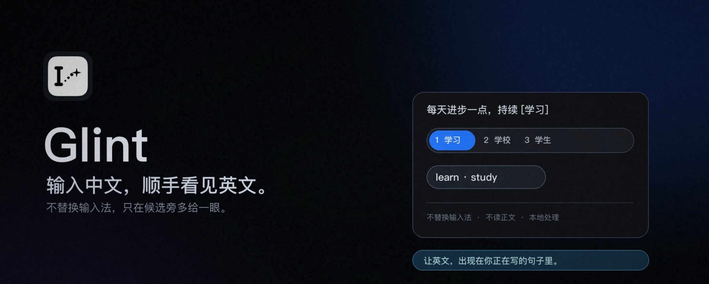

<p align="center">
  
</p>

<p align="center">
  <a href="https://github.com/jsogn/Glint/releases/latest">
    
  </a>
  
  
  
</p>

Glint 是一款为 macOS 打造的英文学习工具。输入中文拼音时，对应的英文翻译会出现在
候选栏旁，不打断输入。它不替换输入法，也不会改变你的输入习惯。

[](https://www.bilibili.com/video/BV1spnb6kEtW/)

## 安装

需要 **macOS 15 或更高版本**，仅支持 **Apple Silicon Mac**。

### 通过 Homebrew 安装

推荐已安装 Homebrew 的用户使用，后续可以直接通过 Homebrew 更新：

```bash
brew tap jsogn/glint
brew trust --cask jsogn/glint/glint
brew install --cask jsogn/glint/glint
```

### 直接下载

普通用户[点击下载最新版安装包](https://github.com/jsogn/Glint/releases/latest)，
推荐选择 `Glint-*-macOS-arm64.pkg`。如果 macOS 首次阻止打开，请在
**系统设置 → 隐私与安全性** 中允许一次，再重新打开安装包。

也可以在下载页选择 DMG，打开后将 Glint 拖入“应用程序”文件夹。不要直接从
DMG 或“下载”目录运行。

## 首次使用

1. 从“应用程序”打开 Glint。
2. 在 **系统设置 → 隐私与安全性 → 辅助功能** 中打开 Glint 的开关，然后重新打开
   Glint。
3. 切换到中文拼音，输入“你好”；候选栏旁出现英文翻译即表示安装成功。

## 特点

- **随手可见**：在拼音候选旁显示英文翻译，不打断输入。
- **覆盖词句**：支持常用词语、短语和短句翻译。
- **词性提示**：选中单词时显示简洁的英文词性缩写。
- **离线可用**：系统翻译、内置词典和本地模型均可在本机运行。
- **按需增强**：可选安装 OPUS-MT 或 MLX 模型，灵活切换翻译来源。
- **插入与朗读**：可将译文插入当前位置，也可手动或自动朗读。
- **自由调整**：显示数量、快捷键、朗读语速和登录启动均可配置。
- **隐私友好**：仅读取当前候选，不读取正文，也不保存输入历史。

## 输入法支持

| 输入法 | 支持程度 | 说明 |
| --- | --- | --- |
| Apple 简体拼音 | ⭐⭐⭐⭐⭐ | 开箱即用 |
| 微信输入法 | ⭐⭐⭐⭐⭐ | 开箱即用 |
| 豆包输入法 | ⭐⭐⭐⭐⭐ | 开箱即用 |
| 搜狗输入法 | ⭐⭐⭐⭐ | 开箱即用 |
| Rime / 鼠须管 | ⭐⭐⭐⭐ | 需在软件内安装候选读取支持 |
| 其他输入法 | ⭐⭐⭐ | 视候选结构而定 |

## 隐私

- 无需账号，不收集候选文本、翻译结果或输入历史。
- 核心词典和模型推理完全在本机完成，日常翻译无需联网。
- 仅在获取可选模型目录、下载或更新模型时联网，不会上传输入内容。
- 只读取输入法候选，不读取输入框正文或选中文字内容。
- 朗读只使用当前候选已经生成的英文译文，不录音、不保存音频，也不联网。
- 不截图，不安装键盘事件监听；插入译文时不写入系统剪贴板。
- 在密码框、终端安全输入等场景中自动跳过。

## 从源码构建

需要 macOS 26、Apple Silicon、Xcode 26 和 XcodeGen：

```bash
git clone https://github.com/jsogn/Glint.git
cd Glint
./scripts/run.sh
```

首次运行测试会准备并校验线上分发的轻量翻译模型数据。修改代码前，建议先阅读
[架构设计](docs/ARCHITECTURE.md)和
[macOS 兼容性](docs/MACOS-COMPATIBILITY.md)。

## Star 趋势

<p align="center">
  <a href="https://www.star-history.com/#jsogn/Glint&amp;Date">
    
  </a>
</p>

## 许可证

Glint 源代码采用 [MIT License](LICENSE)。内置词典、可选翻译模型和第三方运行库
继续遵循各自随附的许可证与署名要求。
