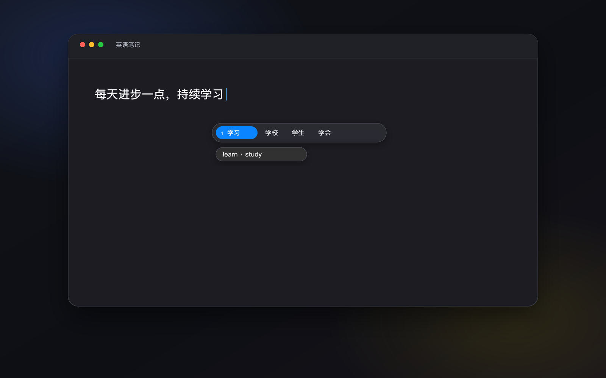

<p align="center">
  
  
  
</p>

Glint 是一款为 macOS 打造的英文学习工具。输入中文拼音时，对应的英文翻译会出现在
候选栏旁，不打断输入。它不替换输入法，也不会改变你的输入习惯。



## 使用方式

1. 从 [GitHub Releases](https://github.com/jsogn/Glint/releases/latest) 下载并
   安装 Glint。
2. 首次启动时，按提示授予辅助功能权限。
3. 切换到苹果拼音 `Pinyin - Simplified`，正常输入中文。
4. 输入中文拼音，对应英文翻译会出现在候选栏旁。

Glint 支持单词、短语和短句。单词会尽量给出简洁、常用的英文对应词，短句则显示
自然翻译。

## 特点

- **安静地融入输入**：只在候选旁显示对应英文翻译，不抢焦点、不替换输入法。
- **专为中文表达设计**：从常见词语到短句，都能获得对应的英文翻译。
- **离线可用**：内置词典和翻译模型，安装后日常翻译无需联网。
- **按需增强**：可以在应用内安装更大的本地翻译模型，获得更自然的句子表达。
- **本地处理**：词典查询和模型推理均在本机完成，候选与译文不会发送到网络。

## 隐私

- 无需账号，不收集候选文本、翻译结果或输入历史。
- 核心词典和模型推理完全在本机完成，日常翻译无需联网。
- 仅在获取可选模型目录、下载或更新模型时联网，不会上传输入内容。
- 只读取输入法候选，不读取输入框正文或选中文字内容。
- 不截图，不安装键盘事件监听。
- 在密码框、终端安全输入等场景中自动跳过。

## 安装说明

当前测试版要求 **macOS 26 或更高版本**，仅支持 **Apple Silicon Mac**。

请先将 Glint 移入“应用程序”文件夹，再从该位置启动。如果 macOS 首次打开时
无法验证应用，请在“系统设置 → 隐私与安全性”中确认一次。

## 从源码构建

需要 macOS 26、Apple Silicon、Xcode 26 和 XcodeGen：

```bash
git clone https://github.com/jsogn/Glint.git
cd Glint
./scripts/run.sh
```

首次构建会准备并校验内置的轻量翻译模型。修改代码前，建议先阅读
[架构设计](docs/ARCHITECTURE.md)。
